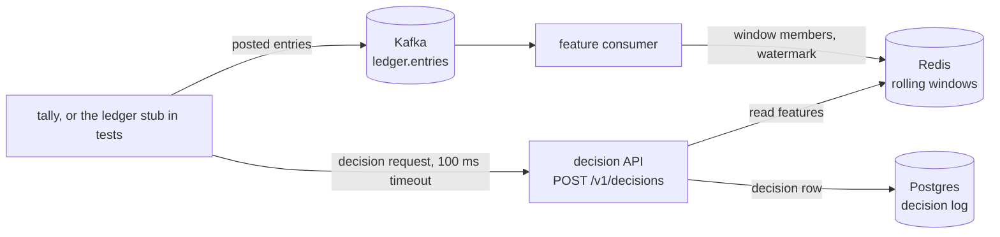

# Risk engine

A streaming risk decision engine for [tally](https://github.com/jenishmsoni45/tally), a double-entry ledger. Before tally posts a transfer it asks this service: **allow**, **hold** or **block**? The answer comes from versioned YAML rules over rolling per-account counts and sums for the last minute, hour and day, built from tally's own event stream. If no answer arrives within the caller's 100 ms timeout, the caller applies a backup answer chosen by the rule set, so an outage here never stalls payments.

It is built to be correct under the conditions real streams create:

- **One key, one answer.** A retried transfer, even one sent concurrently, gets the decision it got the first time (I1).
- **A messy stream doesn't move the numbers.** Duplicate and reordered events never change a feature (I2), and every window equals a recompute from the raw event log (I3).
- **Never hang.** Past its timeout, the caller applies the backup answer (I4).
- **Every decision explains itself.** Each row in the decision log stores the rule-set version, the rules that fired and a snapshot of all 31 features (I5).

2b adds a LightGBM model trained on [PaySim](https://www.kaggle.com/datasets/ealaxi/paysim1), a public labelled fraud dataset, and scores it in shadow next to the rules ([below](#2b-a-model-in-shadow)):

- **Features from one module.** Training sees exactly the features the live service computed: only events before the decision time count (I6), and offline features equal the ones logged online (I7).
- **Shadow can't change a decision.** The model scores after the rules have decided, and its score is stored, never read; a model that fails, talks nonsense or is slow changes nothing (I8).

Each guarantee is an invariant with its own tests, which run in CI on every pull request.

## Architecture



- The **decision API** (FastAPI) validates the request, replays a known `requestId`, reads the features in one Redis script, evaluates the rules (the strictest action that fires wins), stores the decision and answers. It gives up on its own parts after 60 ms and answers 503 rather than a late decision.
- The **feature consumer** reads `ledger.entries`, nets each entry per account, and adds one sorted-set member per account and entry, scored by its time. A repeated event is a no-op, order doesn't matter, and events too late to fall in any window are counted and dropped.
- **Redis** holds nothing that can't be rebuilt: `make rebuild-features` replays the stream and the decision log.
- The **ledger stub** reproduces tally's transfer path (Idempotency-Key rules, the timed decision call, the backup answer, an outbox and relay publishing tally's exact events), so CI tests the contract without tally. `make e2e` checks the same contract against tally itself.

The details live in the docs:

- [requirements.md](docs/requirements.md): what the service must do.
- [architecture.md](docs/architecture.md): the components and sequences.
- [design.md](docs/design.md): the contracts and the failure table.
- [tally-integration.md](docs/tally-integration.md): the contract with tally.
- [decisions.md](docs/decisions.md): why each choice was made, as D-numbers.

## How to run it

You need Docker with Compose, GNU make, [uv](https://docs.astral.sh/uv/) and Python 3.12. uv uses the Python already on the machine and never downloads one. `make bench` also needs [k6](https://k6.io/), and `make e2e` needs a clone of tally.

```sh
make up      # start the stack and wait until every service is healthy
make test    # start the stack, then run every test
make down    # stop the stack (data volumes stay)
```

The services listen on 127.0.0.1 only: the decision API on port 8000, the ledger stub on 8001 and the consumer's metrics on 8002. A decision straight from the API:

```sh
curl -s localhost:8000/v1/decisions -H 'Content-Type: application/json' -d '{
  "requestId": "demo-1",
  "fromAccountId": "00000000-0000-4000-8000-000000000001",
  "toAccountId": "00000000-0000-4000-8000-000000000002",
  "amount": 2500, "currency": "CAD",
  "requestedAt": "2026-11-02T12:00:00Z"
}'
```

The other targets (`make help` lists them all):

| Command | What it does |
|---|---|
| `make lint` | lock check, ruff, ruff format check, mypy (strict) |
| `make audit` | pip-audit on the locked dependencies |
| `make rebuild-features` | refill Redis from `ledger.entries` and the decision log |
| `make bench` | the k6 scenarios, each on its own throwaway stack, into `bench/results/<UTC date>/`; needs the normal stack stopped |
| `make report` | rewrite this README's tables from the newest bench results and the backtest |
| `make check-readme` | fail if this README's tables differ from `make report`'s output (CI runs it) |
| `make e2e` | real tally (`TALLY_DIR`, default `~/Desktop/tally`) against a throwaway stack; needs the normal stack stopped |
| `make profile`, `make paysim-rules`, `make parity`, `make model`, `make backtest` | 2b, on the PaySim CSV you download into `data/` yourself ([below](#2b-a-model-in-shadow)) |
| `make clean` / `make purge` | remove this project's containers, volumes, image and caches |

The rules are in [`risk/rules/ruleset.yaml`](risk/rules/ruleset.yaml) and are read once at startup. An invalid file stops the service, and the caller then applies its backup answer.

## The numbers

`make bench` drives the stack with k6 at a constant arrival rate. Each step lasts 3 minutes, starting at 50 requests a second and doubling until p99 passes the 50 ms budget, errors pass 1%, or k6 can't hold the rate (design.md section 12, D40o, D49). A step that passes a limit runs once more straight away, and a run stops only where both attempts did, so a brief stall of the machine can't end it. The tables show both attempts (D61). Latency is measured at the client. Each scenario starts from an empty stack and runs with the shadow model on, as the service ships; [2b](#2b-a-model-in-shadow) compares the direct and stub runs with it off. `make report` writes the tables below from the result files committed in `bench/results/`, and CI fails if they differ. Every number here comes from that script; none was typed by hand.

<!-- bench:start -->
<!-- Made by `make report` from `bench/results/2026-11-03/`; `make check-readme` fails if it differs. Don't edit by hand. -->

#### Straight to the decision API

| Rate (req/s) | Requests | p50 (ms) | p99 (ms) | Errors | Dropped |
|---:|---:|---:|---:|---:|---:|
| 50 | 9001 | 4.3 | 7.5 | 0.00% | 0 |
| 100 | 17992 | 1.9 | 9.0 | 0.38% | 8 |
| 200 | 36001 | 1.3 | 3.1 | 0.00% | 0 |
| 400 | 72001 | 1.2 | 2.5 | 0.00% | 0 |
| 800 | 143976 | 0.9 | 5.5 | 0.18% | 25 |
| 1600 | 287972 | 2.6 | 84.8 | 18.70% | 28 |

p99 first passes 50 ms at **1600 requests a second**.

#### Through the ledger stub (decision call, posting, relay, consumer)

| Rate (req/s) | Requests | p50 (ms) | p99 (ms) | Errors | Timeout rate | Feature lag p50 (ms) | Feature lag p99 (ms) | Offset lag at end |
|---:|---:|---:|---:|---:|---:|---:|---:|---:|
| 50 | 9000 | 5.0 | 8.1 | 0.00% | 0.00% | 376 | 677 | 15 |
| 100 | 18000 | 2.9 | 5.6 | 0.00% | 0.00% | 376 | 678 | 22 |
| 200 | 36000 | 2.2 | 6.3 | 0.00% | 0.00% | 364 | 669 | 0 |
| 400 | 72001 | 2.2 | 7.3 | 0.00% | 0.00% | 369 | 676 | 0 |
| 800 | 69807 | 2043.0 | 4230.2 | 39.67% | 25.82% | 31833 | 144758 | 12700 |

p99 first passes 50 ms at **800 transfers a second**.

#### Hot account: one receiver, 50 requests a second

| Preloaded events | Members read, median | p50 (ms) | p99 (ms) | Errors |
|---:|---:|---:|---:|---:|
| 1000 | 1000 | 7.0 | 8.2 | 0.00% |
| 10000 | 10002 | 99.6 | 163.7 | 91.09% |

p99 first passes 50 ms with **10000 preloaded events** in the receiver's 24 h window.

Measured on:

- `direct`: Apple M4, 10 cores, 16 GiB, Darwin 27.0.0 27.0; Docker 29.9.2, its VM 5 CPUs and 7.7 GiB; commit `cb14381`, rule set v1; k6 v2.3.0; steps of 180 s.
- `hot`: Apple M4, 10 cores, 16 GiB, Darwin 27.0.0 27.0; Docker 29.9.2, its VM 5 CPUs and 7.7 GiB; commit `28025bf`, rule set v1; k6 v2.3.0; steps of 180 s.
- `stub`: Apple M4, 10 cores, 16 GiB, Darwin 27.0.0 27.0; Docker 29.9.2, its VM 5 CPUs and 7.7 GiB; commit `cb14381`, rule set v1; k6 v2.3.0; steps of 180 s.

<!-- bench:end -->

How to read them:

- **One busy account breaks the budget before total traffic does.** The direct and stub tables spread the load over many accounts and raise the rate. The hot table holds the rate at the direct table's first step and grows one account's window instead. Every decision reads that account's whole 24 h window to compute its sums, so the cost grows with the window, not with the rate (D16). Multi-level buckets are the documented way up (D16). They aren't built; they're a follow-up.
- **Past its last clean step, the path through the stub falls back rather than hangs.** The posting, the relay and the consumer share the machine with the decision API. Once they can't keep up, the stub's backup answer shows up in the timeout rate, and the feature lag grows, as design.md's failure table says it should.
- **Every scenario ran in one session, on one commit** (D57.2), so the tables compare like with like. An earlier hot-account run had used a hot sender, and the bench's own attempts grew the window it was measuring, so the scenario was redesigned around a receiver (D50).

## 2b: a model in shadow

The rules above were written by hand. 2b asks whether a model trained on labelled fraud does better, without letting it near a live decision:

1. **Replay.** [PaySim](https://www.kaggle.com/datasets/ealaxi/paysim1), a month of simulated mobile-money transactions with fraud labels, becomes ledger transfers (`make profile` checks the sample first). You download its CSV into the git-ignored `data/` yourself.
2. **One feature module.** The offline pipeline that builds training data calls the same code the consumer and the API call. Only events before a decision's time count (I6), and `make parity` replays real transfers through the stack and checks that every logged snapshot equals the offline recompute, exactly (I7).
3. **Train honestly.** `make model` trains LightGBM, inside Docker only, on the 31 features the live guard sees: no balance columns and no hour of day, which make PaySim artificially easy (D35, D54). The split is by days, and the threshold holds at most 1% of transfers, the review capacity (D34, D38). The [model card](ml/reports/model_card.md) gives the data, split, threshold, metrics and limitations.
4. **Shadow.** The decision API scores the model after the rules have decided and stores the score next to the decision, which never reads it. Scoring runs on its own thread with a 10 ms limit, so a slow, failing or nonsensical model stores no score and changes nothing (D39, D57.1, I8).
5. **Backtest.** `make backtest` holds a PaySim-scaled copy of the rules (`make paysim-rules`, D54) and the model to the same number of held transfers on the seven test days, which neither saw. Where many transfers share the model's score at that line, it shows the model on both sides of the tie rather than break it arbitrarily (D59). The [report](ml/reports/backtest.md) has the details.

`make report` writes the tables below from `ml/reports/backtest.json` and the bench results, and CI fails if they differ.

<!-- 2b:start -->
<!-- 2b:end -->

## How it was built and verified

[Claude Code](https://claude.com/claude-code) wrote this project's code, tests and docs under my plan and review. I wrote the brief ([PLAN.md](PLAN.md)) and the working rules ([CLAUDE.md](CLAUDE.md)), answered every design question, and accepted or changed every choice made without one. The work went one phase at a time, one pull request per phase:

1. **Phase 0, a plan before any code.** Every open question was put to me with options, trade-offs and a recommendation, and my answer was recorded in [decisions.md](docs/decisions.md). The docs were written only once nothing was open. From then on they were the source of truth: when code and docs disagreed, the docs won.
2. **Each later phase** started only when I named it. It was built in full against the acceptance criteria in [phases.md](docs/phases.md), with a test for every criterion, and reviewed as a diff before the pull request opened. I reviewed every pull request and merged it myself.
3. **Surprises stopped the work.** When a requirement couldn't be met as written, or the docs didn't settle something, the work paused and the question came to me. Those answers are the later D-numbers.

How it is verified:

- **Invariants as tests.** I1 to I8 each have their own suite in `tests/invariants/`, several driven by Hypothesis against an oracle that recomputes features from the raw event log. I7 runs on generated PaySim-format data in CI and on real transfers with `make parity`; I8 compares decisions with stand-in models that fail in every way, and the real model against a shadow-off API.
- **Adversarial and fault tests** in `tests/adversarial/` pause or kill each service in turn (the API, Redis, Postgres, Kafka, the consumer), flush Redis and rebuild it, and flood the stack with repeated events, late events and concurrent requests sharing one `requestId`. They check each row of design.md's failure table.
- **A contract test** checks the stub's events against fixtures captured from tally, and `make e2e` runs tally itself against the service.
- **CI** runs lint, `make check-readme`, the dependency audit and every test on a fresh Compose stack, then checks that `make down`, `make clean` and `make purge` leave nothing behind.
- **Guardrails.** Dependencies are pinned in a lockfile and installed from wheels only, everything runs locally in Docker Compose, and the repo holds no secrets.

[docs/postmortem.md](docs/postmortem.md) tells the story of one real bug found during the build.
