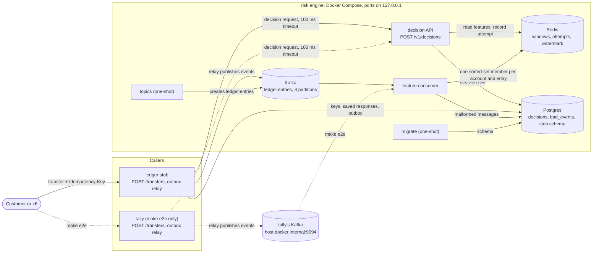
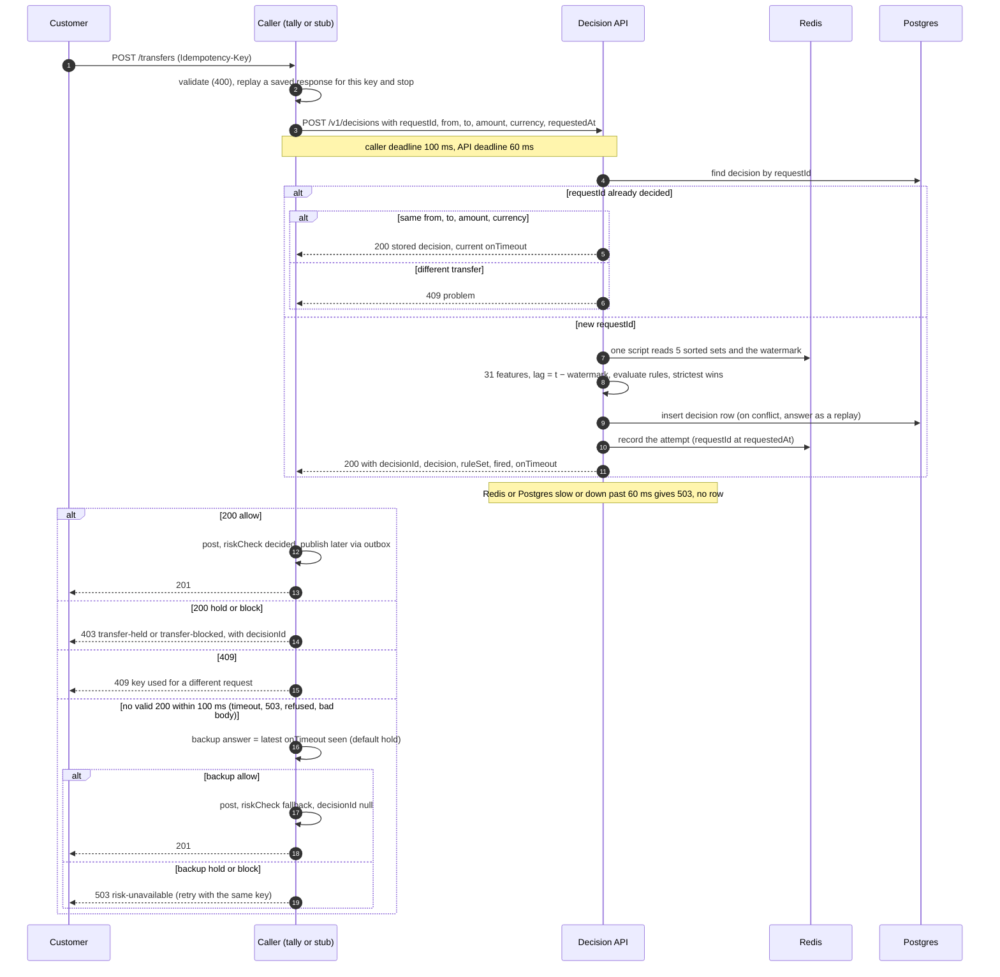
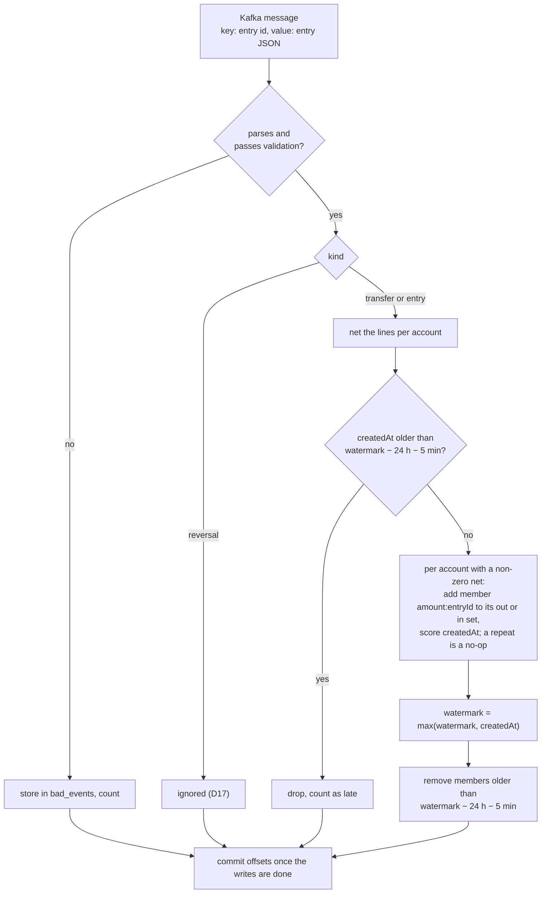
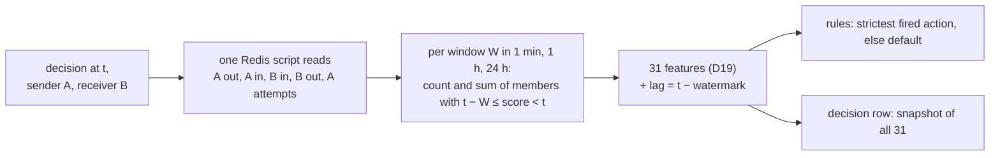
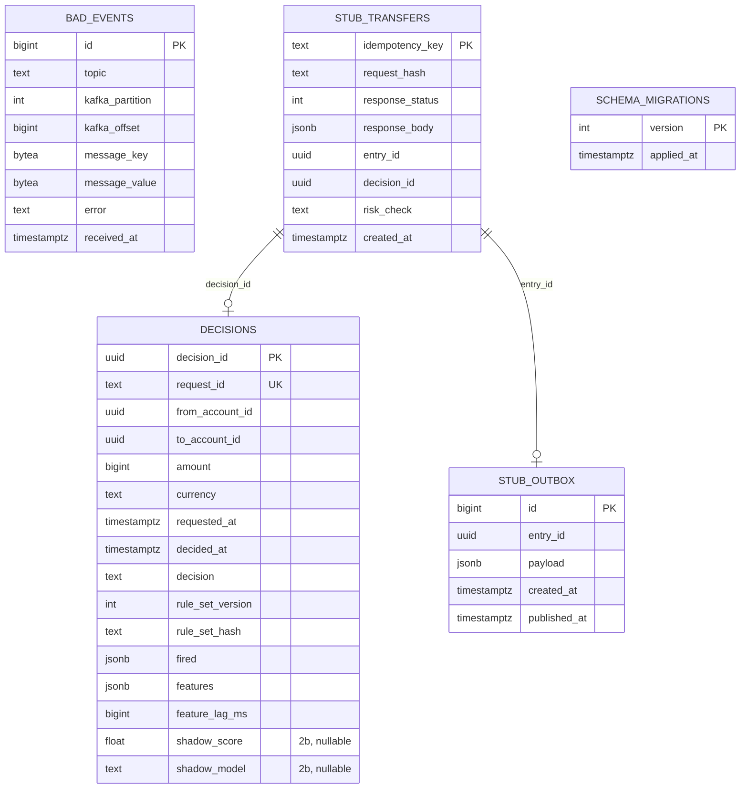
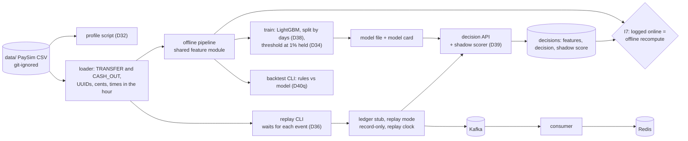

# Architecture

How the risk engine's parts fit together. [requirements.md](requirements.md) says what it must do, [design.md](design.md) gives the contracts and the detailed behaviour, and [decisions.md](decisions.md) records why (D-numbers).

## 1. Components (2a)

| Component | Role | Code (PLAN.md section 7) |
|---|---|---|
| Decision API | Validates the request, replays a known `requestId`, reads features, evaluates rules, stores the decision, records the attempt, answers. In 2b it also scores the shadow model. | `risk/api.py`, `risk/decisions.py`, `risk/store.py` |
| Feature consumer | Reads `ledger.entries`, nets each entry per account, writes window members, keeps the watermark, stores malformed messages | `risk/features/` |
| Feature module | The only feature logic: window membership, netting, the 31 features. Used by the API, the consumer and (2b) the offline pipeline | `risk/features/` |
| Rules | Loads and validates the YAML rule set at startup and evaluates it | `risk/rules/` |
| Ledger stub | tally's transfer path for CI: Idempotency-Key rules, the decision call with tally's timeout and backup answer, an outbox and relay that publish tally-format events (D24) | `ledger_stub/` |
| migrate | Applies numbered SQL migrations before the other services start (D40w) | `risk/migrations/` |
| topics | Creates `ledger.entries` with 3 partitions before the consumer and the stub start (D42) | `docker-compose.yml` |
| Redis | Window and attempt sorted sets, the watermark. Rebuildable, never the source of truth (D40r) | |
| Postgres | The decision log, `bad_events`, the stub's schema | |
| Kafka | This repo's own broker, `apache/kafka:4.3.1` like tally's; `ledger.entries` with 3 partitions like tally's | |

The decision API, the consumer and the stub are separate Compose services built from one image, so a consumer crash never stops decisions (D40j).

## 2. Decision sequence, including the timeout

The caller is tally or the stub; both behave the same (D24). Deadlines: the caller gives up after 100 ms (D4); the decision API gives up on its own parts after 60 ms (D40d).

Points the diagram makes:
- The caller holds no transaction or database connection while it waits (tally-integration.md 4.1).
- A refused transfer saves no key at the caller, so a retry asks again and gets the same decision (I1); a key refused by the backup answer gets a real decision once the API is back.
- Only complete evaluations are stored; a 503 leaves nothing behind (D22).
- Concurrent first requests with one `requestId` race on the insert; the loser reads the winner's row and answers it as a replay (or 409 if the transfer differs), so both get one decision (I1).

## 3. From event to feature

Why this order is safe:
- Every write is idempotent: the same entry always yields the same member, so a duplicate changes nothing (I2), and arrival order doesn't matter (I2). Offsets are committed only after the writes, so a crash replays messages rather than losing them (D40h).
- Late events are applied whenever they can still count (D15). The watermark is event time, so a replay behaves the same at any speed.
- The read takes a window ending just before t, so an event at t or later never counts (I6).

## 4. Data model

### Postgres

- `decisions` is the decision log and the attempt log (D18). Its constraints enforce I5; design.md lists them.
- `stub_transfers` and `stub_outbox` live in the `stub` schema (D40l). Only posted transfers have a saved response and an outbox row, like tally.

### Redis

| Key | Type | Member | Score | Written by |
|---|---|---|---|---|
| `f:{accountId}:out` | sorted set | `{amount}:{entryId}` | `createdAt`, epoch ms | consumer |
| `f:{accountId}:in` | sorted set | `{amount}:{entryId}` | `createdAt`, epoch ms | consumer |
| `a:{accountId}` | sorted set | `{amount}:{requestId}` | `requestedAt`, epoch ms | decision API |
| `wm` | string | latest `createdAt` applied, epoch ms | | consumer |

The amount comes first in the member because a `requestId` may contain a colon. A decision reads the sender's `out`, `in` and `a` sets and the receiver's `in` and `out` sets.

## 5. Deployment

| Service | Image | Host port (127.0.0.1) | Depends on |
|---|---|---|---|
| `migrate` | this repo's image | none | postgres healthy |
| `topics` | `apache/kafka:4.3.1` | none | kafka healthy |
| `api` | this repo's image | 8000 | migrate done, redis and postgres healthy |
| `consumer` | this repo's image | 8002 (metrics only, D40z) | migrate and topics done, redis and kafka healthy |
| `stub` | this repo's image | 8001 | migrate and topics done, api and kafka healthy |
| `postgres` | `postgres:18.6` | 5433 | |
| `redis` | `redis:8.10.3` (D42) | 6379 | |
| `kafka` | `apache/kafka:4.3.1` | 19092 | |

The ports avoid tally's (D31), so both stacks run at once for `make e2e`.

- **Stub mode** (default, CI): the stub is the caller and this repo's Kafka carries the events.
- **e2e mode** (`make e2e`, local only, D26): tally from the owner's clone is the caller, with `TALLY_RISK_ENABLED=true` and `TALLY_RISK_URL=http://localhost:8000`; the consumer reads tally's broker at `host.docker.internal:9094`. `make e2e` starts this repo's stack fresh and gives the consumer a new consumer group that starts at the end of tally's topic, so events left from tally's own runs never reach the windows.

## 6. 2b: replay, offline pipeline, model and shadow

- The offline pipeline and the consumer share one feature module; the offline side feeds it the loader's transfers as ledger events, in time order.
- In replay mode the stub posts every transfer whatever the decision, and takes each transfer's time from the replay (D40u, D40v), so online and offline features cover the same events.
- The shadow scorer runs inside the decision API after the rules decide; its output is stored and never read by the decision (I8).
